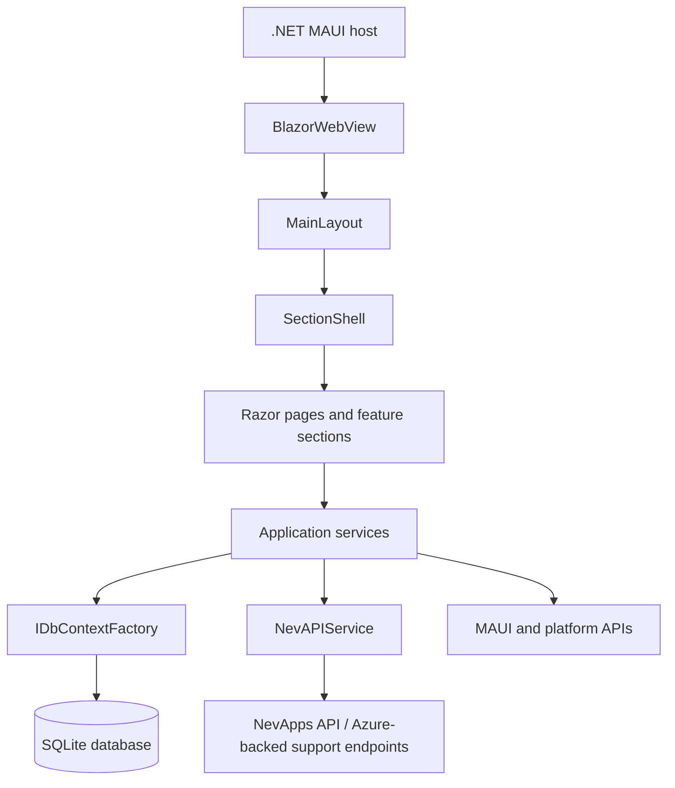
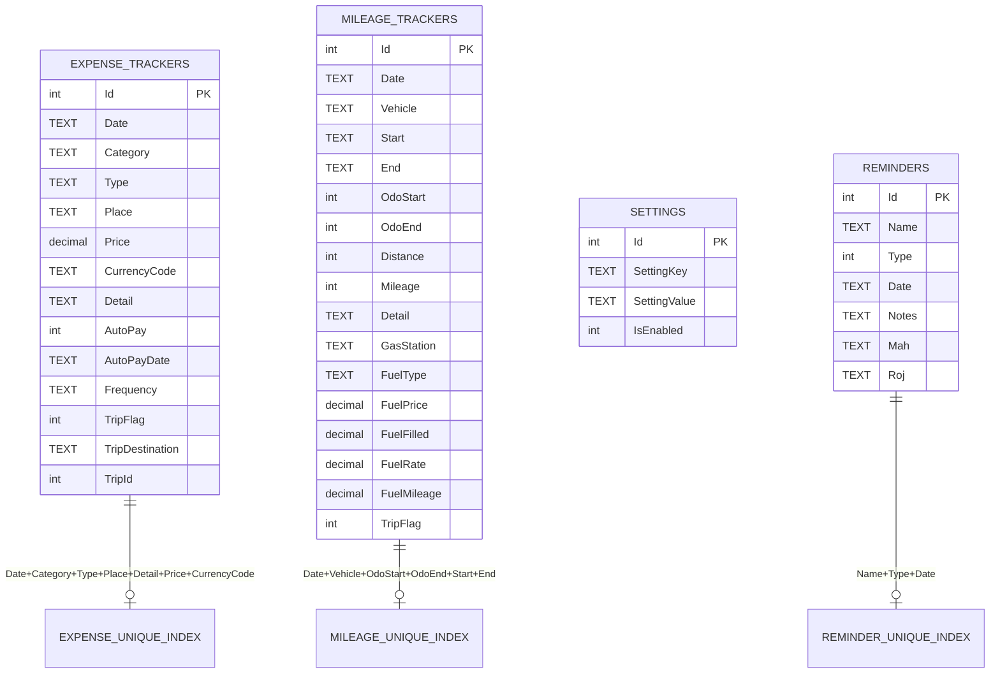

# NevApps Architecture

NevApps is a .NET MAUI Blazor Hybrid mobile application. The UI is rendered with
Blazor and MudBlazor inside the native MAUI WebView. Local application data is
stored in SQLite through Entity Framework Core.

| Area               | Technology                                          |
|--------------------|-----------------------------------------------------|
| Application        | .NET 10, .NET MAUI                                  |
| UI                 | Blazor Hybrid, Razor components, MudBlazor          |
| Local database     | SQLite 3, EF Core, migrations                       |
| Native integration | MAUI Essentials, platform-specific Android/iOS code |
| Remote services    | `NevAPIService` over `HttpClient`                   |
| OCR                | `Plugin.Maui.OCR`                                   |

## Runtime composition

`MauiProgram.CreateMauiApp` registers the database factory, UI services, domain
services, native platform services, OCR, and HTTP clients. The SQLite database
is created under `FileSystem.AppDataDirectory` and pending migrations from the
`NevDBClass` project are applied during startup.

## UI and navigation

`MainLayout.razor` provides the MudBlazor theme, app bar, settings/navigation
actions, detail-page back action, and the fixed bottom back strip for
non-shell routes.

`SectionShell.razor` keeps the main feature sections mounted and supports
horizontal swipe navigation. `Classes/NavSections.cs` defines the canonical
section order and filters it using the enabled feature flags:

| Route                  | Section                                    |
|------------------------|--------------------------------------------|
| `/`                    | Dashboard/Home                             |
| `/expense-tracker/add` | Expense Tracker                            |
| `/mileage-tracker/add` | Mileage Tracker                            |
| `/shenshai/view`       | Shenshai Calendar                          |
| `/steps-tracker/add`   | Steps Tracker                              |
| `/view-settings`       | Settings                                   |
| `/view-support`        | Admin support entries, only when available |

Expense, Mileage, Shenshai, and Steps routes are included according to the
saved feature settings. Settings is always available. The Support route is
available only to administrators when feedback or issue entries exist.

Detail routes, such as tracker View/Edit pages, are not part of the swipe
section list. They use `MainLayout`'s detail navigation and scroll container.

## WebView and mobile keyboard behavior

The application intentionally keeps scrolling inside the CSS detail-page
container rather than nesting native MAUI scrolling controls inside Razor
components.

- `wwwroot/app.css` defines `.app-main-detail` as the detail-route scroller.
- iOS WebView scrolling is configured in `MainPage.xaml.cs`.
- Android uses `WindowSoftInputMode.AdjustResize` in
  `Platforms/Android/MainActivity.cs`.
- `wwwroot/index.html` shows the CSS loading screen inside `#app` until Blazor
  replaces it, and contains iOS focus handling that scrolls the active input
  inside `.app-main-detail` without resizing the whole layout.
- Add-page content includes extra bottom scroll space while the keyboard is
  visible so lower panels and action buttons can be reached manually.

This arrangement avoids the blank-space behavior caused by combining a
keyboard-resized WebView with nested native `ScrollView` or forced global
`scrollIntoView` behavior.

## Database schema

The EF Core model is defined in `NevDBClass.Data.SqLiteDbContext`. Migrations
are stored in `NevDBClass/Migrations`.

Dates are stored as text using `yyyy-MM-dd`. Expense, Mileage, and Reminder
records have unique indexes configured in `SqLiteDbContext`.

Reminder rows keep the original Gregorian date plus Roj and Mah. The dashboard
and the View grid project the next occurrence on or after today from that Roj
and Mah. The View grid orders by that next date. The saved date is shown next
to the reminder type.

The `Settings` table stores feature flags, country/currency values, category
values, vehicle values, support state, announcements, and other app settings.
Vehicle image files are not stored in SQLite. The current dashboard image flow
stores optimized image files in `FileSystem.AppDataDirectory` and keeps the
local file path in `Settings`.

## Service layer

Services are registered through dependency injection in `MauiProgram.cs`.
They are independent services; there is no inheritance relationship between
the tracker services.

| Service                 | Responsibility                                                                                 |
|-------------------------|------------------------------------------------------------------------------------------------|
| `ExpenseTrackerService` | Expense/income CRUD, search, totals, autocomplete data                                         |
| `MileageTrackerService` | Mileage CRUD, search, vehicle data, fuel summaries, autocomplete data                          |
| `ReminderService`       | Reminder data and calendar-related operations                                                  |
| `SettingsService`       | Settings persistence, feature flags, country/currency data, support state, vehicle image paths |
| `BackupRestoreService`  | SQLite backup creation, restore, deletion, and full data clearing                              |
| `NevAPIService`         | Health checks, announcements, feedback, issues, and developer replies                          |
| `ReceiptService`        | Receipt image processing and OCR preparation                                                   |
| `StateService`          | In-memory and preferences-backed application state                                             |
| `LoggerService`         | Local diagnostic logging, including exception message and stack for issue reports              |

The autocomplete controls use service search methods and MudAutocomplete's
visible-item limit. Main tracker lists use MudDataGrid pagination where
appropriate.

## Settings feature dependencies

The Settings page uses `AppSelection` to control which dependent panels are
shown:

| Enabled feature             | Visible settings                          |
|-----------------------------|-------------------------------------------|
| Expense Tracker             | Country Selection and Category Selection  |
| Mileage Tracker             | Country Selection and Vehicle Selection   |
| Both Expense and Mileage    | Country, Category, and Vehicle Selection  |
| Neither Expense nor Mileage | Country, Category, and Vehicle are hidden |

Theme selection is always shown. Shenshai and Steps can be enabled
independently of Expense and Mileage.

Saving Settings updates imperial units only when the country name changes.
United States turns imperial on. Any other country turns it off. The mileage
unit toggle overrides that choice until the country changes again.

The Save operation validates and persists only the data required by the
selected features.

## Dashboard vehicle images

The Mileage Dashboard displays one summary card per vehicle. Vehicles are
ordered by the most recent record with `FuelFilled > 0`; vehicles without a
fuel/energy fill are placed afterward.

Image behavior:

1. The user selects an image through the MAUI file picker.
2. The app displays that the image is stored in local app storage, not the
   database.
3. The image is resized and saved locally.
4. SQLite stores the association between the vehicle name and local path.
5. Removing an image clears the stored path and refreshes the dashboard.

The current implementation uses PNG output for uploaded images. Built-in
vehicle icons remain the fallback when no image is available.

## Backup and restore

`BackupRestoreService` manages local SQLite backup files. The Settings page
lists available backups, shows the selected backup name in delete
confirmation, and supports:

- Named local backups
- Restore of a selected local backup
- Admin restore from a picked external database file
- Deletion of an individual backup
- Clearing all application data

Admin database export uses the platform share flow and writes a temporary
export file to the app cache directory.

## Remote support and announcements

`NevAPIService` communicates with the NevApps API for:

- API health checks
- Broadcast/announcement retrieval
- User feedback submission
- Issue/log submission
- Developer feedback and issue replies

Each install stores its own id in SQLite. Feedback is uploaded under
`{id}_{timestamp}`, and the admin reply is stored in the cloud under that same
id. This phone asks only for replies that begin with its id. Another install
does not load that message or reply. Restoring this phone’s backup onto
another phone copies the id, so that phone is treated as this device.

After a reply is saved, the Support button reads **View Feedback** and opens
the message and the reply. Marking the reply read clears only the unread flag
on `dev_feedback`. The posted feedback and the reply text stay. The Settings
badge counts unread replies.

An issue report uploads the device details plus the exception type, message,
and stack trace. NevAPI accepts the file unless a blob with that exact name
already exists.

The admin Support page shows Feedback and Issues tabs. Opening it reloads both
lists. Tab badges show the current counts and disappear at zero. The app bar
and swipe shell expose the admin Support route only while at least one
feedback or issue entry is waiting.

## Platform-specific behavior

Platform-specific files are isolated under `Platforms` and in the MAUI host:

- Android configures keyboard resize behavior and Android step tracking.
- iOS configures safe-area behavior, WebView scrolling, and iOS step tracking.
- MAUI Essentials provides file picking, sharing, permissions, and device
  services.

The shared Razor layer remains the primary UI and business-flow layer, while
native code is used only where WebView or platform APIs require it.
